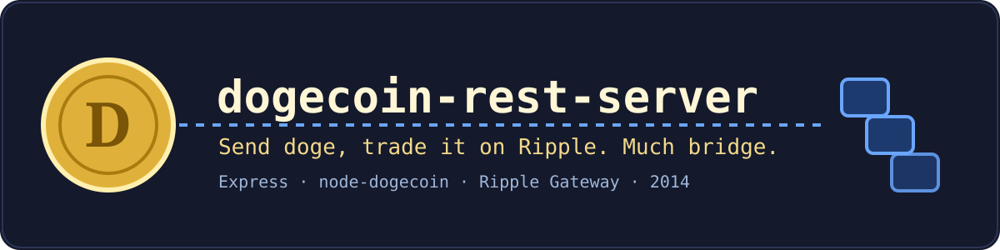
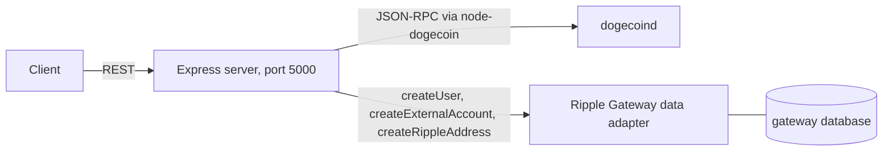

<p align="center"></p>

<p align="center">
  
  
  
</p>

> [!NOTE]
> **Historical project (March 2014). Not maintained and not working as committed.** Written for Node 0.10 and Express 3, in the Dogecoin meme-coin era. `index.js` does not even parse as it stands (see [docs/STATUS.md](docs/STATUS.md)). Kept for the record. Do not deploy it.

# dogecoin-rest-server

**Dogecoin Ripple Gateway.** Send dogecoins to your Ripple wallet and trade them on the global worldwide crypto Ripple liquidity exchange.

It is a small Express REST server that would sit next to a Dogecoin daemon: it creates Dogecoin deposit addresses, and bridges each one to a Ripple address through the [Ripple Gateway](https://github.com/ripple/ripple-gateway) software, so that coins sent to the Dogecoin address would show up as IOUs on Ripple. Much bridge, very liquidity.

## Planned endpoints

The README of the day sketched these calls. Addresses below are placeholders, not real values.

| Call | What it was meant to do |
|---|---|
| `GET /wallet/new` | Generate a new Dogecoin address: `{ address }` |
| `GET /wallet/new?key=1` | The same, and also return the address's private key (a bad idea over plain HTTP; do not copy it) |
| `POST /bridges` | Connect a Ripple address to a fresh Dogecoin address. Body: `ripple_address`, `email_address`, `password`. README promised `{ id, email_address, ripple_address, dogecoin_address }`; the code returns `{ user, ripple_address, dogecoin_address }` and reads `user`, not `email_address` |
| `GET /bridges/dogecoin/:dogecoin_address` | Look up the Ripple address bridged to a Dogecoin address |
| `GET /bridges/ripple/:ripple_address` | Look up the Dogecoin address bridged to a Ripple address |

Example (shape only):

```
GET /wallet/new
{ address: "<dogecoin address>" }

POST /bridges
{ ripple_address: "<ripple address>", email_address: "<email>", password: "<password>" }
```

## How it works



`index.js` reads the Dogecoin RPC credentials from the environment (`DOGECOIND_USER`, `DOGECOIND_PASSWORD`), asks `dogecoind` for new addresses, and records the pairing of user, Dogecoin address and Ripple address through a Ripple Gateway data adapter (`ripple-gateway-data-sequelize-adapter`).

## Deploy tooling (sketch)

The last commits added deployment scaffolding. All of it is template-level and unfinished:

- **Capistrano 3.1** (`Capfile`, `config/deploy.rb`, `config/deploy/*.rb`): still the stock generated files, with `my_app_name` and `example.com` placeholders.
- **Chef cookbook** (`cookbooks/nginx/`): installs an nginx site and an Upstart job for the gateway. Note that the recipe refers to a `dogecoin_gateway.conf.erb` template that is not in the repo (only a non-ERB `dogecoin_gateway.conf` is), and the nginx upstream points at port 3000 while the server listens on 5000.

## Install and run (as it would have been)

```
npm install
export DOGECOIND_USER=...   # your dogecoind rpcuser
export DOGECOIND_PASSWORD=...
node index.js
```

This needs a running `dogecoind` with RPC enabled and the Ripple Gateway data adapter, neither of which is included. As committed it fails with a syntax error. `npm test` runs `mocha test/`, but there is no `test/` directory.

## Layout

```
index.js                        the Express server (routes only)
package.json                    express 3, node-dogecoin, mocha, sinon
Capfile, Gemfile, config/       stock Capistrano 3.1 scaffolding
cookbooks/nginx/                Chef recipe and nginx / upstart templates
docs/                           status and banner
```

## History

- **2014-03-08:** server with `/wallet/new`, README with the proposed bridge calls.
- **2014-03-09:** `POST /bridges` and the two lookups implemented.
- **2014-03-11 to 03-15:** Capistrano, Chef nginx cookbook, nginx upstream. Last commit.
- 14 commits in a week. One of Steven's 2014 experiments bridging other blockchains into Ripple gateways **(inference)**.

---

Status and what was checked: [docs/STATUS.md](docs/STATUS.md). Notes for coding agents: [AGENTS.md](AGENTS.md).
